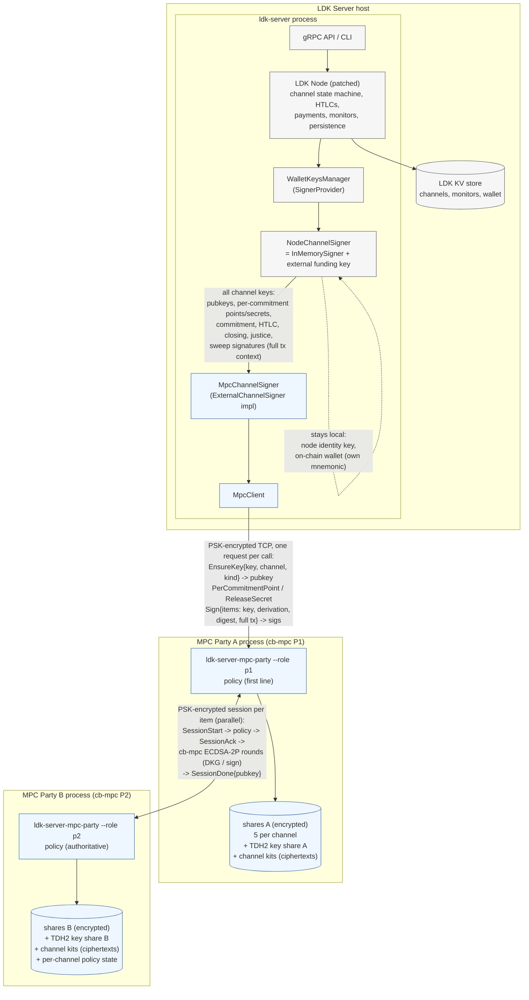

# ldk-server fork: Coinbase cb-mpc channel signing for Lightning

**This is a fork of [lightningdevkit/ldk-server](https://github.com/lightningdevkit/ldk-server)
whose only purpose is to test putting Lightning channel keys under Coinbase's
[cb-mpc](https://github.com/coinbase/cb-mpc) 2-of-2 ECDSA MPC.** It is not a release of LDK
Server; for the daemon itself use upstream. Upstream's README, API docs and contribution
guide are unchanged under `docs/`, `ldk-server-grpc/` and `CONTRIBUTING.md`.

## In short

A Lightning node normally keeps every channel key on one machine, so whoever controls that
machine controls the funds. This fork splits every channel key of an LDK Server node between
two separate processes using Coinbase's cb-mpc 2-of-2 ECDSA: neither process ever holds a
complete key, and every signature needs both. The second process is not a rubber stamp. It
rebuilds each transaction from the bytes it is given, checks the key and the channel state,
keeps the revocation secrets itself, tracks the node's balance, and refuses to sign old
states, balance-draining updates, or closes and sweeps to addresses it does not know.

This runs real Lightning end to end: channel open, payments in both directions, restarts,
cooperative close and force-close, on regtest with every key split and on signet against a
third-party LND node with the funding-key version. Compared with stock LDK Server, the host
is left with only the node's network identity and a receiving wallet; it cannot move channel
funds without the second party's agreement. This is what VLS or LND's remote signer offer,
done with Coinbase's MPC library on today's non-taproot channels.

Two caveats. It is a proof of concept: one evening of work, both parties on one machine,
reviewed by no one but its author, with a policy that covers the big cases but not HTLC
accounting, and two small key-derivation helpers added outside cb-mpc's audited public API.
And the on-chain wallet is the one key still on the host: channel funds can now only be sent
into that wallet, but once there the host can spend them. Moving that last signer off-host is
ordinary engineering and the next step. Do not use this with real funds.

## What it does

Every channel key of an LDK Server node (funding, payment, delayed-payment, HTLC and
revocation basepoints) is a cb-mpc 2-of-2 distributed key. The per-commitment (revocation)
secrets exist online only as threshold-encrypted entries of a channel kit, made by an offline
ceremony; a secret is decrypted only when both parties agree to release it, and neither party
holds the seed. Two independent MPC processes each hold one share of every key; the
complete private keys are never assembled. Per-commitment keys are derived on the shares with
the BOLT 3 tweaks (two small additions to cb-mpc's ECDSA-2P API, included as a patch).

Party B is a validating signer: it recomputes every sighash from the transaction it is given,
checks that the key kind matches the operation and that derivations match BOLT 3, keeps
commitment numbers monotonic, checks the counterparty's signature on each new holder
commitment itself and contributes to releasing a per-commitment secret only after that, tracks the node's balance in every commitment and caps how much it
may drop per update, and only signs cooperative closes and sweeps that pay an allow-listed
script (the node's wallet xpub). Links are PSK-authenticated and encrypted; key shares are
encrypted at rest. All Lightning channel state stays in LDK Server / LDK Node.

## Status (2026-10-08)

- **Regtest, full coverage:** two LDK Servers, one MPC-backed. Channel open (five DKGs),
  payments both ways, restart of the MPC parties, restart of LDK Server, cooperative close
  with a DKG'd key verified in the on-chain 2-of-2 script, and a holder force-close, with
  PSK links, encrypted shares and Party B allow-listing the wallet xpub. `e2e-tests/tests/mpc.rs`.
- **Signet, funding-key coverage:** channels with Blink's staging LND node and a second LDK
  Server; keysend sent, 20,000 sat received, 7,000 sat sent, restart with shares restored,
  cooperative close and force close confirmed on-chain with the DKG'd keys in their witness
  scripts. Log in [`docs/mpc-signet-demo.md`](docs/mpc-signet-demo.md).
- **Latency, both parties on one machine:** commitment update 53 ms, with one HTLC 64 ms,
  closing 47 ms; a payment adds roughly 110 to 130 ms. [`docs/mpc-benchmarks.md`](docs/mpc-benchmarks.md).
- **Revocation secrets (branch `mpc`, 2026-11-09):** no party holds the commitment seed any
  more. An offline ceremony tool makes channel kits of TDH2-encrypted secrets; both parties
  must agree to decrypt one, and each checks the counterparty's signature on the new holder
  commitment itself first. Covered by unit, service and the regtest tests below; not run on
  signet.
- **Tests:** `cargo test -p ldk-server-mpc` (DKG/sign/derivation, policy, secure transport,
  service, kits, threshold decryption) and `cd e2e-tests && cargo test --test mpc -- --test-threads=1` (regtest,
  downloads bitcoind).

## Not yet covered

- The on-chain wallet mnemonic is still on the LDK Server host. It is separate from the node
  seed (`onchain_wallet_mnemonic_path`) and Party B only pays out to its addresses, so a host
  compromise can force funds *into* the wallet but not elsewhere; moving on-chain signing
  off-host is the remaining step.
- Party B must run on separate infrastructure with its own operator to be a trust boundary.
- Revocation secrets: a kit covers a fixed number of channel states and must be refilled by
  the ceremony before it runs out, or the channel stops. The master seed is whole during a
  ceremony run, offline. The TDH2 key share cannot be refreshed yet (cb-mpc's public API has
  no refresh for it). Funding scripts and counterparty keys are pinned on first use, so a
  splice's new funding is trusted when first signed for.
- HTLC-level accounting is not enforced; counterparty revocation notices are recorded, not
  verified. The balance cap is a per-update delta, not a price-based rule.
- The two cb-mpc derivation functions use cb-mpc's internal key representation and are outside
  its public, bug-bounty-covered API.
- Splicing and the full-coverage mode were not exercised on signet.

## Where things are

- [`ldk-server-mpc/`](ldk-server-mpc/): cb-mpc FFI, party service, client, policy, secure
  transport. [`ldk-server-mpc/README.md`](ldk-server-mpc/README.md) has the detailed design,
  build steps (cb-mpc, custom OpenSSL, patched ldk-node) and security notes.
- [`ldk-server/src/mpc_signer.rs`](ldk-server/src/mpc_signer.rs): the `ExternalChannelSigner`
  implementation; `[mpc]` config in [`docs/configuration.md`](docs/configuration.md).
- [`contrib/patches/`](contrib/patches/): the ldk-node patch (`ExternalChannelSigner`,
  separate wallet entropy, `signer_unblocked` poke) and the cb-mpc derivation patch. The
  workspace `Cargo.toml` expects the patched ldk-node at `../ldk-node` and cb-mpc at
  `../cb-mpc`.
- [`contrib/mpc-signet/`](contrib/mpc-signet/): signet config and party launch scripts.

## Build and run

```bash
# one-time: cb-mpc (+ derivation patch) with its custom OpenSSL, and the patched ldk-node
#           (see ldk-server-mpc/README.md)
cargo build --release -p ldk-server -p ldk-server-cli -p ldk-server-mpc

# Party A (creates the PSK / share key files if missing)
target/release/ldk-server-mpc-party --role p1 --listen 127.0.0.1:7701 --peer 127.0.0.1:7702 \
  --keystore mpc/a --auth-key-file mpc/client.psk --peer-auth-key-file mpc/peer.psk \
  --share-key-file mpc/share-a.key
# LDK Server on a FRESH storage dir with [mpc] party_address / coverage / auth_key_path and
# [node] onchain_wallet_mnemonic_path; it writes <storage>/onchain_wallet_xpub
target/release/ldk-server my-config.toml
# Party B (on separate infrastructure) with the wallet xpub allow-listed
target/release/ldk-server-mpc-party --role p2 --listen 127.0.0.1:7702 --keystore mpc/b \
  --peer-auth-key-file mpc/peer.psk --share-key-file mpc/share-b.key \
  --payout-xpub "$(cat <storage>/onchain_wallet_xpub)" --max-balance-decrease-sat 100000

# Offline ceremony (air-gapped machine): once the parties have written mpc/a/tdh2.pub, make
# channel kits and copy them to BOTH parties' kit directories. No channel opens without one.
target/release/ldk-server-mpc-ceremony new-seed --threshold 3 --pieces 5 --out-dir pieces
target/release/ldk-server-mpc-ceremony new-kits --piece pieces/piece-1.txt \
  --piece pieces/piece-2.txt --piece pieces/piece-3.txt --fingerprint <from new-seed> \
  --tdh2-public-key mpc/a/tdh2.pub --kits 10 --states 50000 --out-dir kits
cp kits/*.kit mpc/a/kits/ && cp kits/*.kit mpc/b/kits/
```

## Architecture



- **LDK Server** owns all Lightning state and the on-chain wallet; it never sees a funding
  private key.
- **Party A (P1)** is the only endpoint LDK Server talks to and the only party that
  obtains the final signature (a property of cb-mpc ECDSA-2P). It holds the A shares and
  runs the policy as a first line.
- **Party B (P2)** only accepts protocol sessions from Party A, holds the B shares, its share
  of the TDH2 key, a copy of the channel kits and the per-channel policy counters, and is the authoritative
  policy. It never sees LDK's database; everything it checks it recomputes from the
  transaction bytes in the request.

## Signing flow for one commitment update (funding signature + one HTLC signature)

```text
 LDK channel state machine        MpcChannelSigner           Party A (P1)                    Party B (P2)
 ────────────────────────         ────────────────           ────────────                    ────────────
 sign_counterparty_commitment ─┐
   build commitment + HTLC txs │
   funding sighash, HTLC sighash
                               ├─▶ items: [funding key, none, digest, full tx ctx],
                               │          [htlc basepoint, +SHA256(pcp‖base), digest, htlc tx ctx]
                               │   Sign{channel, items} ──▶ policy.authorize(each item)
                               │                            derive share (+tweak) locally
                               │                            ┌─ session 1 ──SessionStart──▶ policy: sighash ✓, key kind ✓,
                               │                            │                               derivation ✓, commitment nr ✓,
                               │                            │                               balance by script ✓ (cap)
                               │                            │  ◀──── SessionAck ────────── derive share B (+tweak)
                               │                            │  ◀═ cb-mpc ECDSA-2P sign ═▶
                               │                            │  ◀──── SessionDone{pubkey}── commit state
                               │                            └─ session 2 (in parallel) ... same for the HTLC item
                               │                            verify each sig vs derived pubkey, low-S
                               │   ◀── [sig, sig]
                               │   verify vs locally derived pubkeys
 ◀─ (funding sig, HTLC sigs) ──┘
 ...
 validate_holder_commitment(n) ──▶ HolderCommitmentValidated{n} ──▶ (mirror) ──▶ record n
 validate_holder_commitment(n) carries the commitment tx and the counterparty's signature;
 each party verifies them itself before recording n.
 release_commitment_secret(n+1) ─▶ ReleaseSecret{n+1} ──▶ policy ✓, partial decryption A
                                                          ──▶ ReleaseSecret ──▶ policy: n+1 > validated(n) ✓
                                                          ◀── partial decryption B (own kit copy)
                                   ◀── secret ◀── combine, check against the per-commitment point
```

## What is MPC-backed (`coverage = "all"`)

| Key / operation                                        | Backing                                    |
|--------------------------------------------------------|--------------------------------------------|
| Funding key, spliced funding keys                      | **cb-mpc 2-of-2 (A + B)**, fresh DKG per splice |
| Payment point (`to_remote`)                            | MPC                                        |
| Delayed-payment / HTLC basepoints and per-commitment keys | MPC, per-commitment key = share + BOLT 3 tweak |
| Revocation basepoint and revocation keys               | MPC, `share·H1 + secret·H2` on shares      |
| Per-commitment secrets and points                      | Offline ceremony; secrets threshold-encrypted (cb-mpc TDH2), both parties decrypt under policy |
| Commitment, HTLC, closing, anchor, splice, justice, sweep signatures | MPC                           |
| Node identity, gossip, BOLT12                          | local                                      |
| On-chain wallet (BDK)                                  | local, own mnemonic; Party B only pays out to its addresses |

`coverage = "funding"` keeps the original funding-key-only mode.

With full coverage and Party B on separate infrastructure, an attacker who controls the LDK
Server host cannot produce any channel signature, sweep any channel output, obtain a
per-commitment secret early, get an old state or a balance-draining commitment signed, or
redirect a close or sweep away from the allow-listed wallet. They can still broadcast the
latest already-signed commitment (a force-close whose outputs only sweep to the wallet),
stall the node, and spend the on-chain wallet, whose mnemonic remains on the host
(`onchain_wallet_mnemonic_path` keeps it separate from the node seed; moving it off-host is
the remaining step).

## Measured performance (Apple M4, both parties on one machine, cb-mpc `0b71670`)

| Operation                                               | p50     | p95     | p99     | Throughput |
|---------------------------------------------------------|---------|---------|---------|------------|
| DKG, one key (full path)                                | 151 ms  | 400 ms  | 400 ms  | ~5 /s      |
| DKG, all five channel keys in parallel (channel open)   | ~430 ms wall |    |         |            |
| Sign, one key, concurrency 1                            | 42.6 ms | 43.6 ms | 45.3 ms | 23.4 /s    |
| Sign, one key, concurrency 4                            | 46.0 ms | 52.1 ms | 56.6 ms | 85.5 /s    |
| Commitment update, no HTLC (policy + 1 session)         | 53 ms   |         | 65 ms   |            |
| Commitment update with 1 HTLC (2 parallel sessions)     | 64 ms   |         | 89 ms   |            |
| Signet: commitment / closing / holder commitment        | 40–66 / 40 / 44–73 ms |  |        |            |

Each party uses ~3.4 MB RSS and 35–50 % of one core while signing at concurrency 1. A
direct-channel BOLT11 payment adds roughly 110–130 ms of MPC time (two commitment updates,
each with the HTLC signature in parallel); on signet a 20,000 sat receive completed 164 ms
after the send command. See [`docs/mpc-benchmarks.md`](docs/mpc-benchmarks.md).

## Upstream

Everything outside the files listed above is upstream LDK Server at commit 08316de (synced
2026-10-07). See [lightningdevkit/ldk-server](https://github.com/lightningdevkit/ldk-server).
