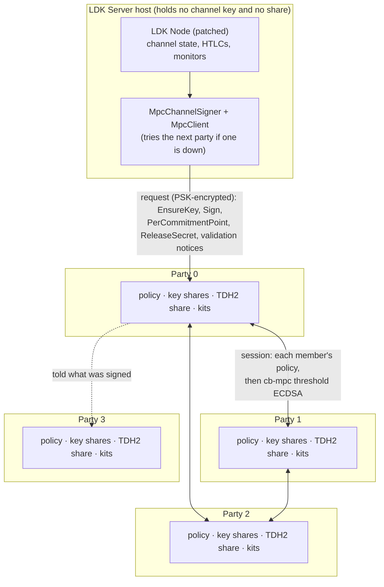

# ldk-server-mpc: Coinbase threshold MPC channel signing for LDK Server

Takes **every Lightning channel key** of an LDK Server node off its host and shares it, with
Coinbase's [`cb-mpc`](https://github.com/coinbase/cb-mpc) threshold ECDSA, among several
independent parties: the funding key and the payment, delayed-payment, HTLC and revocation
basepoints. Any `threshold` of the parties sign together (three of four in the tests); fewer
learn nothing, and the complete private keys are never assembled anywhere. The per-commitment
(revocation) secrets are threshold-encrypted under a joint cb-mpc TDH2 key and decrypted only
when a quorum agrees (see [Revocation secrets](#revocation-secrets)).

Every party enforces the same policy from its own record of the channel (recomputed
sighashes, key-kind binding, BOLT 3 derivation checks, monotonic commitment numbers, verified
holder commitments, ordered secret release, balance tracking, payout allow-list). All
Lightning channel state stays in LDK Server / LDK Node; the parties keep only key shares,
kits and policy state.

`coverage = "funding"` keeps the original funding-key-only mode.

## Architecture



- **LDK Server** owns all Lightning state and the on-chain wallet. It holds no channel key
  and no share, and can send a request to any party.
- **The party that gets a request leads it.** It applies its policy, picks a quorum
  (itself and `threshold - 1` others) and opens a session with each member. Every member
  applies its own policy before it accepts. Only then do the members link up with each
  other and run the cb-mpc protocol; the leader gets the signature. If a member is down or
  refuses, the leader tries the next quorum. Parties outside the quorum are told what was
  signed so their record keeps up.
- **Key generation** runs among all parties. Each stores its share only after the leader
  has confirmed that all of them computed the same public key.
- **Links between parties** are encrypted, and each end proves its Ed25519 identity by
  signing a value bound to that connection and to the roster (the parties, their identities
  and the threshold), so parties with different rosters cannot talk at all.

### Why three of four

A party's policy is only as good as its record of the channel, and a party that was down has
an outdated one. With three of four, any two quorums share two parties. So when at most one
party is compromised, every quorum contains an honest party that took part in the previous
operation, and it refuses anything that contradicts it. That is why a compromised host plus
one compromised party cannot play two groups against each other, for instance to get a state
revoked through one group and then signed for broadcast through another. Two of three does
not have this property (two quorums can share only the compromised party); two of two has it
but stops whenever either party is down.

### Signing flow for one commitment update (funding signature + one HTLC signature)

```text
 LDK channel state machine     MpcChannelSigner        leading party              two more parties
 ────────────────────────      ────────────────        ─────────────              ────────────────
 sign_counterparty_commitment
   build commitment + HTLC txs
   funding sighash, HTLC sighash
                          ──▶  items: [funding key, none, digest, full tx ctx],
                                      [htlc basepoint, +SHA256(pcp‖base), digest, htlc tx ctx]
                               Sign{channel, items} ──▶ policy.authorize(each item)
                                                        SessionStart{members, items} ──▶ policy: sighash ✓, key kind ✓,
                                                                                         derivation ✓, commitment nr ✓,
                                                                                         balance by script ✓ (cap)
                                                        ◀──────────── SessionAck ───────
                                                        go ──▶                           members link up with each other
                                                        ◀═ cb-mpc threshold ECDSA, item by item, shares tweaked locally ═▶
                                                        verify each sig vs derived pubkey, low-S
                                                        ◀──────────── SessionDone ────── commit state
                               ◀── [sig, sig]           tell the fourth party what was signed
 ...
 validate_holder_commitment(n) carries the commitment tx and the counterparty's signature;
 every party verifies them itself before recording n.
 release_commitment_secret(n+1) ──▶ ReleaseSecret{n+1, proof of n} to every party: policy, then a
                                    partial decryption of its own kit copy; three recover the secret,
                                    which is checked against the per-commitment point.
```

## What is MPC-backed and what is not

With `coverage = "all"` (default):

| Key / operation                                        | Backing                                   |
|--------------------------------------------------------|-------------------------------------------|
| Funding key (2-of-2 funding multisig), spliced funding keys | **cb-mpc threshold ECDSA**, fresh key generation per splice |
| Payment point (`to_remote`)                            | MPC (static key)                          |
| Delayed-payment basepoint and per-commitment keys      | MPC; per-commitment key = share + BOLT 3 tweak |
| HTLC basepoint and per-commitment keys                 | MPC; same                                 |
| Revocation basepoint and revocation keys               | MPC; `share * H1 + secret * H2` on shares |
| Per-commitment secrets / points                        | Offline ceremony; secrets TDH2-encrypted, a quorum decrypts under policy |
| Commitment, closing, anchor, announcement, splice sigs | MPC                                       |
| HTLC signatures (commitment updates, HTLC txs, claims) | MPC (one after another within a request)  |
| Justice transactions                                   | MPC                                       |
| Sweeps of `to_remote` / delayed `to_local` outputs     | MPC                                       |
| Node identity key, gossip, BOLT12, onion keys          | local (`KeysManager`)                     |
| On-chain wallet (BDK)                                  | local; own mnemonic (`onchain_wallet_mnemonic_path`) |

With `coverage = "funding"` only the first row is MPC-backed and everything else is the
local `InMemorySigner`.

### What this protects

An attacker who controls the LDK Server host (seed, database, process), **even together
with one of the parties**, cannot:

- sign any commitment, closing, splice, anchor, HTLC, justice or sweep transaction: that
  takes three shares, and at least two of the three belong to honest parties whose policy
  must allow it;
- make the parties believe a holder commitment was validated: each checks the counterparty's
  signature on the commitment transaction, and the commitment number it encodes, against the
  funding script and counterparty keys it pinned for the channel;
- obtain a per-commitment secret ahead of its state being superseded, or get a superseded
  state signed for broadcast, including by routing the request through a party whose record
  is outdated;
- get a commitment signed that drops our balance by more than the configured cap, a
  cooperative close that does not pay our tracked balance to an allow-listed script, or a
  sweep to a non-allow-listed script;
- feed a party a fake transaction: each recomputes every sighash from the transaction,
  input, value and witness script it is given, and verifies key derivations against the
  per-commitment point / revealed secret.

What a host compromise can still do: broadcast the latest *already-signed* holder commitment
(a force-close; the resulting outputs can only be swept to allow-listed scripts via MPC),
stall the node, leak the node identity key, and spend the on-chain wallet (its mnemonic is
still on the host; see remaining work). Two compromised parties together with the host hold
enough shares that only the third member's policy stands in the way; three hold everything.

## Components

- `src/ffi.rs` – raw declarations for the cb-mpc C API used here (threshold ECDSA-MP with an
  access structure, TDH2, memory helpers).
- `src/mp.rs` – safe wrappers for threshold ECDSA: `Threshold` (the access structure),
  `dkg`, `sign`, `refresh`, and local share derivation (`derive_additive_tweak`,
  `derive_mul_add`). The library runs each protocol on the calling thread and exchanges
  messages through an `MpTransport`.
- `src/tdh2.rs` – safe wrappers for cb-mpc's TDH2 threshold decryption (key generation,
  encrypt, verify, partial decrypt, combine).
- `src/mesh.rs` – identity keys, the roster, authenticated links, and the mesh of links a
  session runs over (each link has a reader thread, so two parties sending large protocol
  messages at once never block each other).
- `src/protocol.rs` – minimal binary wire format: client requests and responses, and the
  session messages between parties.
- `src/party.rs` – the party service: leading requests, taking part in sessions led by
  others, the key-share store (`<keystore>/<key_id>.share`, one file per key, written
  atomically, encrypted with the share key). Every signature is verified against the derived
  public key and normalized to low-S before it is returned.
- `src/client.rs` – `MpcClient`, blocking, with bounded timeouts and failover across the
  parties' addresses.
- `src/policy.rs` – `ChannelPolicy`, run by every party. Per channel it records the key id
  of each key kind, the commitment / balance state and what it pinned about the channel. It
  verifies, for every signature: the recomputed sighash, the key kind for the operation, the
  BOLT 3 derivation, commitment-number monotonicity, our balance (located by script, not by
  metadata) against `--max-balance-decrease-sat`, and payout destinations (`--payout-xpub`,
  `--payout-address`) for closes and sweeps. It also verifies holder-commitment proofs and
  decides when this party contributes to releasing a per-commitment secret.
- `src/kit.rs` – channel kits: the file format, the kit store with its kit-to-channel
  bindings, kit generation for the ceremony, and Shamir splitting of the master seed.
- `src/secure.rs` – forward-secret encrypted framing (X25519 + HKDF-SHA256 + AES-256-GCM)
  for all links, and AES-256-GCM encryption of shares at rest.
- `src/bin/party.rs` – `ldk-server-mpc-party`.
- `src/bin/ceremony.rs` – `ldk-server-mpc-ceremony new-seed | new-kits | refill`.
- `src/bin/bench.rs` – `ldk-server-mpc-bench` latency benchmark.

### LDK integration points

- **ldk-node patch** (`contrib/patches/ldk-node-external-funding-signer.patch`, applied in
  the sibling checkout `../ldk-node`, wired via `[patch]` in the workspace `Cargo.toml`):
  - `ldk_node::signer::ExternalChannelSigner` trait: `channel_pubkeys`, `funding_pubkey`,
    `per_commitment_point`, `release_commitment_secret`, the two validation notices (the
    holder-commitment one carries the commitment transaction and the counterparty's
    signature) and batch `sign(requests)`. Every `SignRequest` carries the full transaction, input, value,
    witness script, sighash type and channel parameters.
  - `ldk_node::signer::NodeChannelSigner`, the node's `SignerProvider::EcdsaSigner`. With
    `KeyCoverage::AllChannelKeys` every `ChannelSigner`/`EcdsaChannelSigner` method and the
    `OutputSpender` sweeps go to the external signer; with `FundingOnly` just the funding
    key does.
  - `Builder::set_external_channel_signer`, `Builder::set_onchain_wallet_entropy`, and a
    5-second `signer_unblocked` poke so signatures that failed while the MPC was unreachable
    are retried.
  - Signers are restored through `SignerProvider::derive_channel_signer(channel_keys_id)`,
    so no serialization format changes.
- **ldk-server** (`ldk-server/src/mpc_signer.rs`): `MpcChannelSigner` maps
  `channel_keys_id` to one MPC key id per key kind (tagged SHA-256) and a policy channel
  id, runs the five DKGs in parallel on first use, derives the public keys for tweaked
  requests locally to verify signatures, and keeps undeliverable state notices in an
  ordered retry queue (an `Err` from LDK's validation callbacks would close the channel).
- Config: `[mpc] party_address = "127.0.0.1:7701,127.0.0.1:7702,..."` (every party's client
  address; the next is tried when one is unreachable), `coverage = "all" | "funding"`,
  `auth_key_path = "<32-byte PSK file the parties use as --auth-key-file>"`, optional
  `request_timeout_secs`, `dkg_timeout_secs`. LDK Server writes the wallet's BIP 84 account
  xpub to `<storage>/onchain_wallet_xpub` for the parties' `--payout-xpub`.
- **Separate on-chain wallet seed**: `[node] onchain_wallet_mnemonic_path = "<file>"` (or
  `--node-onchain-wallet-mnemonic-path` / `LDK_SERVER_NODE_ONCHAIN_WALLET_MNEMONIC_PATH`).
  The ldk-node patch adds `Builder::set_onchain_wallet_entropy`, which derives the BDK
  wallet descriptors from that mnemonic while node identity, channel keys and LSPS/LNURL
  keys keep using the node mnemonic. Without it, LDK Node derives both from one seed, so a
  stolen node seed also controls every sweep destination. Fresh nodes only.

Per-commitment keys use one small addition to cb-mpc
(`contrib/patches/cb-mpc-additive-tweak-derivation.patch`): `ecdsa_mp::derive_mul_add_ac`
derives a party's share of `key * m + a` from its share of `key` (`m = 1` for the BOLT 3
per-commitment keys, both terms for revocation keys). With a single threshold gate the shares
are points on a polynomial, so every party applies the same map to its own share and to the
public shares; it is local and needs no round trip. Derived shares are used for one signature
and never refreshed or stored. Spliced funding keys use a fresh key generation keyed by
`(channel_keys_id, splice_parent_funding_txid)`.

## Building

1. Build cb-mpc (with the derivation patch) and its custom OpenSSL (one-time; macOS arm64
   shown; on Linux use `scripts/openssl/build-static-openssl-linux.sh`):

   ```bash
   git clone https://github.com/coinbase/cb-mpc ../cb-mpc
   cd ../cb-mpc && git checkout 0b71670 && git submodule update --init vendors/secp256k1
   git am ../ldk-server/contrib/patches/cb-mpc-additive-tweak-derivation.patch
   pip3 install --user cmake            # if cmake is not installed
   export CBMPC_OPENSSL_ROOT=$PWD/openssl-3.6.4-install
   bash scripts/openssl/build-static-openssl-macos-m1.sh
   cmake -S . -B build/release -DCMAKE_BUILD_TYPE=Release -DBUILD_TESTS=OFF \
         -DCBMPC_OPENSSL_ROOT=$CBMPC_OPENSSL_ROOT
   cmake --build build/release -j8      # produces lib/Release/libcbmpc.a
   ```

   `build.rs` looks for `../cb-mpc` relative to the workspace (override with `CBMPC_DIR`,
   `CBMPC_LIB_DIR`, `CBMPC_OPENSSL_ROOT`).

2. Check out the patched ldk-node next to this repository:

   ```bash
   git clone https://github.com/lightningdevkit/ldk-node ../ldk-node
   cd ../ldk-node && git checkout 179b4b263762155a7ff515ddad7e757a80807fd5
   git am ../ldk-server/contrib/patches/ldk-node-external-funding-signer.patch
   ```

3. `cargo build --release -p ldk-server -p ldk-server-cli -p ldk-server-mpc`

## Running

Four parties, any three of which must agree. On one machine for a trial; on separate
infrastructure with separate operators for the split to mean anything.

```bash
# 1: each party creates its identity key and prints the public half; exchange them
for p in a b c d; do ldk-server-mpc-party --keystore mpc/$p --share-key-file mpc/share-$p.key \
  --print-identity; done

# 2: the same roster on every party, same order (name=address for other parties=identity)
ROSTER="--threshold 3 --party a=127.0.0.1:7711=<id a> --party b=127.0.0.1:7712=<id b> \
  --party c=127.0.0.1:7713=<id c> --party d=127.0.0.1:7714=<id d>"

# 3: LDK Server (fresh storage dir) with [mpc] party_address = "127.0.0.1:7701,...,127.0.0.1:7704",
#    auth_key_path, and [node] onchain_wallet_mnemonic_path. It needs one party up to start
#    and writes <storage>/onchain_wallet_xpub.

# 4: every party, with the wallet xpub allow-listed (--auth-key-file is created if missing;
#    LDK Server and every party need the same file)
ldk-server-mpc-party --name a --listen 127.0.0.1:7701 --keystore mpc/a $ROSTER \
  --auth-key-file mpc/client.psk --share-key-file mpc/share-a.key \
  --payout-xpub "$(cat <storage>/onchain_wallet_xpub)" --max-balance-decrease-sat 100000
# ... and likewise b, c, d on 7702, 7703, 7704

# 5: once all are up, the first party in the roster runs the TDH2 key generation and every
#    party writes <keystore>/tdh2.pub. Offline ceremony (see "Revocation secrets"):
ldk-server-mpc-ceremony new-seed --threshold 3 --pieces 5 --out-dir pieces
ldk-server-mpc-ceremony new-kits --piece pieces/piece-1.txt --piece pieces/piece-2.txt \
  --piece pieces/piece-3.txt --fingerprint <from new-seed> --tdh2-public-key mpc/a/tdh2.pub \
  --kits 10 --states 50000 --out-dir kits
for p in a b c d; do cp kits/*.kit mpc/$p/kits/; done

# 6: channel keys are generated on first channel open (five key generations per channel);
#    that needs every party up. From then on any three are enough.
```

Enable MPC only on a fresh node. Existing channels were created with locally derived
funding keys; `derive_channel_signer` would hand them an MPC pubkey that does not match
the on-chain funding script. If no party is reachable when a channel signer must be derived
(startup, channel open), the node aborts with a clear error rather than running with a
mismatched key.

## Revocation secrets

BOLT 3 derives a channel's per-commitment secrets from one seed through a SHA-256 hash tree,
and the counterparty checks every secret against that tree. Hashes cannot be computed on key
shares, so whoever holds the seed holds every future secret of the channel. Here no online
machine does:

- **Joint TDH2 key.** When all parties are up they run cb-mpc's TDH2 key generation once,
  under the same threshold as the signing keys. Each keeps a share (`tdh2.keyshare`,
  encrypted at rest) and writes the public key to `<keystore>/tdh2.pub`. It is a dedicated key, never a signing key.
- **Offline ceremony** (`ldk-server-mpc-ceremony`, on an air-gapped machine). `new-seed`
  creates the master seed and splits it into custodian pieces (Shamir, any `threshold` of
  `pieces`); the seed itself is not stored. `new-kits` rebuilds it from the pieces, checks its
  fingerprint, and for each kit derives a channel seed, computes the secrets and their public
  points, and encrypts each secret to the TDH2 public key under a label naming the kit and
  the commitment number. `refill` adds further states to an existing kit.
- **Kits.** A `.kit` file holds only public points and ciphertexts. Every party needs a copy
  in their kit directory (`--kit-dir`, default `<keystore>/kits`). A kit is bound to a channel
  on its first use, on every party, for good; a channel cannot open if no unused kit is left,
  and stops when its kit runs out, so refill before then (the leading party logs a warning below 256
  states left).
- **Release.** For `release_commitment_secret(n)` the leading party asks every party. Each
  one whose policy finds a newer holder commitment validated partially decrypts **its own
  copy** of the kit entry (never a ciphertext handed to it). Any `threshold` of those parts
  recover the secret, which the leader checks against the entry's point. The label stops a
  ciphertext for one commitment being passed off as another's.
- **Validation is checked, not reported.** `validate_holder_commitment` forwards the
  commitment transaction and the counterparty's signature. Each party verifies the signature
  under a funding script it pinned when it first signed for the channel, and that the
  transaction's locktime and sequence encode the claimed commitment number. A compromised
  host that merely claims "validated" gets no secret. The first commitment of a channel needs
  no proof, since nothing can be released on its strength.

Enable MPC only on a fresh node. Existing channels were created with locally derived
funding keys; `derive_channel_signer` would hand them an MPC pubkey that does not match
the on-chain funding script. If the MPC service is unreachable when a channel signer must
be derived (startup, channel open), the node aborts with a clear error rather than running
with a mismatched key. The request to release a secret carries the
  same proof, so a party that was down when the commitment was validated checks it then and
  catches up.

## Tests

```bash
cargo test -p ldk-server-mpc                 # unit + service tests
cd e2e-tests && cargo test --test mpc -- --test-threads=1   # regtest, downloads bitcoind
```

- `src/mp.rs`, `src/tdh2.rs`: every quorum of a 3-of-4 key signs and decrypts and two
  parties cannot; derived keys sign for the expected derived public keys; refresh keeps the
  key and retires old shares; label binding.
- `src/kit.rs`: BOLT 3 Appendix D vectors, LDK's shachain store accepting decrypted
  secrets, kit segments and bindings, seed splitting.
- `src/mesh.rs`: mutual authentication, an impostor, mismatched rosters, links that carry
  large messages both ways at once.
- `src/policy.rs`: sighash mismatch, key-kind mismatch, HTLC and revocation derivation
  checks, commitment monotonicity with the balance cap, holder-commitment proofs, pinned
  channel parameters, secret release ordering, closing allow-list, sweep destinations.
- `tests/service.rs`: four parties over TCP. Key generation, signing and restart; signing
  with each party down in turn and failing with two down; key generation storing nothing
  when a party is missing; secured links and encrypted shares; and for revocation secrets:
  ten updates whose secrets LDK's shachain store accepts, a host claiming validation
  without proof / with a forged signature / with another state's signature, a compromised
  party asking the others directly or speaking for another party, a channel running with
  each party down in turn, a party that missed updates catching up from the proof, a
  revoked state refused even when the request goes through a party with an outdated record,
  kit exhaustion and refill, and kit pooling.
- `e2e-tests/tests/mpc.rs`: two `ldk-server` processes on regtest, server A with full MPC
  coverage across four party processes and kits from the real ceremony tool: open channel,
  pay both directions, restart all parties, pay with one party down and with the leading
  party down, restart LDK Server, cooperative close (closing tx's 2-of-2 redeem script
  contains a distributed key), and a separate holder force-close test.

## Security notes / remaining work

- **On-chain wallet mnemonic is still on the LDK Server host.** With
  `onchain_wallet_mnemonic_path` it is at least not derivable from the node seed, and the
  parties only sign closes/sweeps to that wallet's addresses, so a host compromise can force
  funds *into* the wallet but not elsewhere. Moving on-chain signing off-host is the
  remaining step to make channel funds unreachable from the host.
- **The parties must run on separate infrastructure** with separate administrators. On one
  machine they are process boundaries, not trust boundaries.
- **Share keys and the client PSK are files.** They are generated with `0600` permissions
  and should be kept on a different medium than the keystore (or in a KMS/HSM).
- **Key shares are not refreshed yet.** `mp::refresh` is wrapped and tested but not exposed
  through the service; cb-mpc's public API has no refresh for TDH2 key shares.
- **Key generation needs every party**, so a channel cannot open while one is down, and a
  party that loses its keystore cannot rejoin (the others refuse to regenerate a key).
- **Policy scope.** The balance cap is a per-update delta, not a price-based rule, and off
  unless `--max-balance-decrease-sat` is set; HTLC accounting (which HTLCs may be settled)
  is not enforced. Counterparty revocation notices are recorded but not verified.
- **Pinning is trust on first use.** The funding script and counterparty basepoints a party
  checks holder commitments against are the ones in the first counterparty commitment it
  signed for that funding. A splice's new funding is therefore trusted when first signed for,
  and splice transactions themselves are signed without output checks.
- **Outdated records.** A party that was down is told nothing on its return; it catches up
  on validated commitments from the proof in a release request, and on signed states the
  next time it takes part or is told of a signing. Until then requests that depend on its
  record are carried by the other three.
- **Revocation secrets.** The master seed is whole on the ceremony machine for the length of
  a run. A kit covers a fixed number of states; without a refill the channel stops. Released
  entries are not deleted from kit files.
- **cb-mpc full API.** `derive_mul_add_ac` uses cb-mpc's internal key representation and is
  outside the public API's bug-bounty surface. It is valid only for a single threshold gate.
- **Latency.** A threshold signature takes several times longer than the earlier two-party
  protocol, and the signatures of one request are made one after another. A leader also
  retries a dead member on every request instead of remembering it. See
  `docs/mpc-benchmarks.md`.
